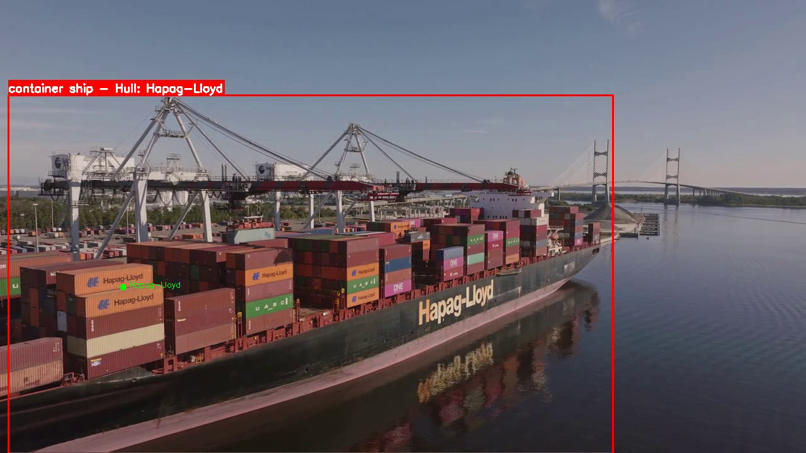
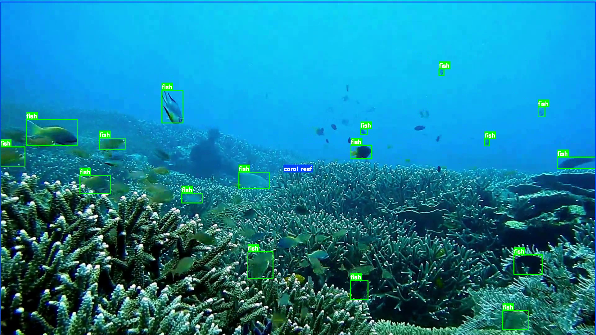
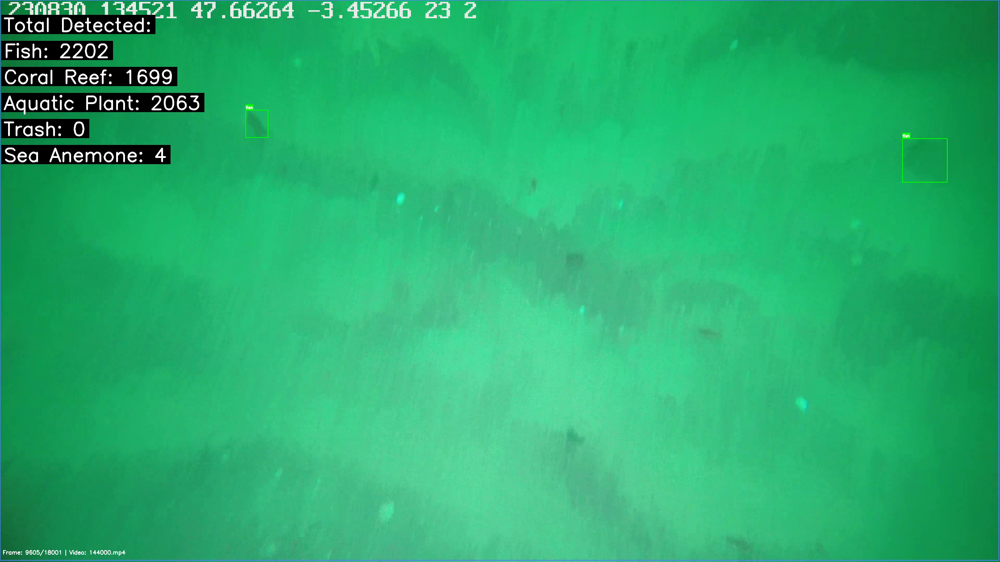
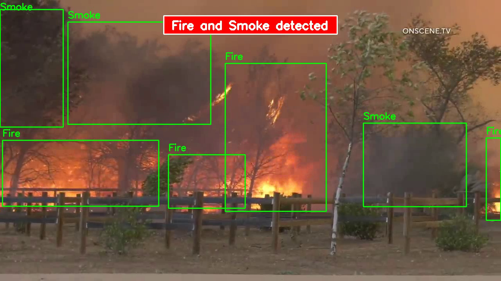

# 🌊 Maritime & Subsea Vision AI: Surface Vessel OCR, Marine Ecological Analytics & Wildfire Detection

[](https://pytorch.org/)
[](https://developer.nvidia.com/cuda-toolkit)
[](https://ultralytics.com/)
[](https://github.com/JaidedAI/EasyOCR)
[](https://opensource.org/licenses/MIT)

A comprehensive, GPU-accelerated computer vision platform engineered for maritime domain awareness, subsea ecological surveying, commercial vessel identification, and environmental hazard detection.

---

## 📸 Visual Detections & System Performance

### 1. Surface Vessel Classification & Hull Number OCR
Automated vessel segmentation combined with CLAHE image enhancement and GPU EasyOCR to identify commercial carriers in real time.


### 2. Subsea Ecological & Marine Biodiversity Analytics
Simultaneous detection and spatial tracking of coral reefs and fish species.


### 3. Quantitative Marine Flora & Debris Assessment
Live aggregate counting of marine life, flora, and plastic/ocean waste.


### 4. Environmental Hazard & Smoke/Fire Monitoring
Continuous PTZ stream surveillance for forest fire and industrial smoke detection.


---

## 📊 Benchmark Analytics & Quantitative Findings

Our automated underwater ecological survey logged **91,120 total detections** across high-definition subsea video transects:

| Category | Specific Class | Video Transect 1 | Video Transect 2 | Combined Detections |
| :--- | :--- | :--- | :--- | :--- |
| **Marine Fauna** | Fish Species | 17,917 | 30,298 | **48,215** |
| **Reef & Flora** | Aquatic Plants | 13,724 | 17,579 | 31,303 |
| | Coral Reef Structures | 4,741 | 4,556 | 9,297 |
| | General Marine Life | 281 | 1,288 | 1,569 |
| | Sea Anemones | 29 | 30 | 59 |
| | **Flora/Fauna Subtotal** | **18,775** | **23,453** | **42,228** |
| **Ocean Debris** | Bottle Screws | 105 | 306 | 411 |
| | Ropes / Abandoned Gear | 16 | 141 | 157 |
| | Bottle Caps | 33 | 11 | 44 |
| | Loose Trash & Plastics | 11 | 19 | 30 |
| | Barrels, Cans, Tires, Shoes, Bags | 26 | 9 | 35 |
| | **Debris Subtotal** | **191** | **486** | **677** |
| **Grand Total** | | **36,883** | **54,237** | **91,120** |

---

## 🚀 Key Architectural Modules

1. **Surface Vessel Detection (`vessel_detection.py`)**:
   - Detects and categorizes 8 vessel classes: *Barge, Cargo Ship, Container Ship, Cruise Ship, Ferry, River Boat, Sailboat, Yacht*.
   - Hardware-enforced GPU inference with memory caching.

2. **Hull OCR Recognition (`hull_ocr_recognition.py`)**:
   - Isolates vessel hull region using segmentation masks.
   - Applies dual contrast enhancement (2.0×), sharpness filtering (1.5×), and CLAHE adaptive histogram equalization.
   - Post-processes text with fuzzy pattern matching to identify shipping lines (*Evergreen, Maersk, COSCO, ONE, Hapag-Lloyd, MSC, etc.*).

3. **Subsea Ecosystem & Debris Tracker (`underwater_species_analyzer.py`)**:
   - Multi-class tracking for aquatic ecosystems.
   - On-screen aggregate analytics HUD.

4. **Wildfire & Smoke Detector (`fire_smoke_detector.py`)**:
   - Designed for 24/7 RTSP/ONVIF streams from PTZ surveillance cameras.
   - Achieves $\ge 80\%$ True Positive Rate while suppressing false positives (glare, fog, thermal plumes).

---

## 🛠️ Quickstart & Installation

```bash
# Clone the repository
git clone https://github.com/mh-masum6875/maritime-underwater-vision-ai.git
cd maritime-underwater-vision-ai

# Install dependencies
pip install -r requirements.txt
```

### Running Vessel Detection:
```bash
python src/vessel_detection.py --source data/vessel.mp4 --conf 0.25
```

### Running Hull Number OCR:
```bash
python src/hull_ocr_recognition.py --source data/container_ship.mp4
```

### Running Underwater Marine Survey:
```bash
python src/underwater_species_analyzer.py --source data/subsea_survey.mp4
```

---


---

## 🌊 Extended Maritime & Environmental Intelligence Capabilities

This platform's core architecture extends across multi-domain marine and environmental monitoring:

- **Surface Vessel Domain Awareness**: Long-range classification of 8 maritime vessel classes with automated size categorization.
- **Commercial Shipping Line OCR**: CLAHE adaptive image preprocessing paired with GPU-accelerated OCR for container carrier registry matching.
- **Subsea Ecological Population Census**: Validated on **91,120 logged detections** quantifying marine fauna, aquatic flora, and coral structures.
- **Ocean Waste & Plastic Debris Mapping**: Subsea detection tracking bottle screws, ropes, plastics, tires, and lost fishing nets.
- **Continuous Wildfire & Industrial Smoke Surveillance**: Day/night PTZ stream inference ($\ge 80\%$ TPR) with optical glare and thermal plume filtering.
- **Oil Spill & Environmental Anomaly Alerting**: REST and Webhook streaming architecture for instant pollution containment dispatch.

## 📄 License
This project is licensed under the MIT License.
